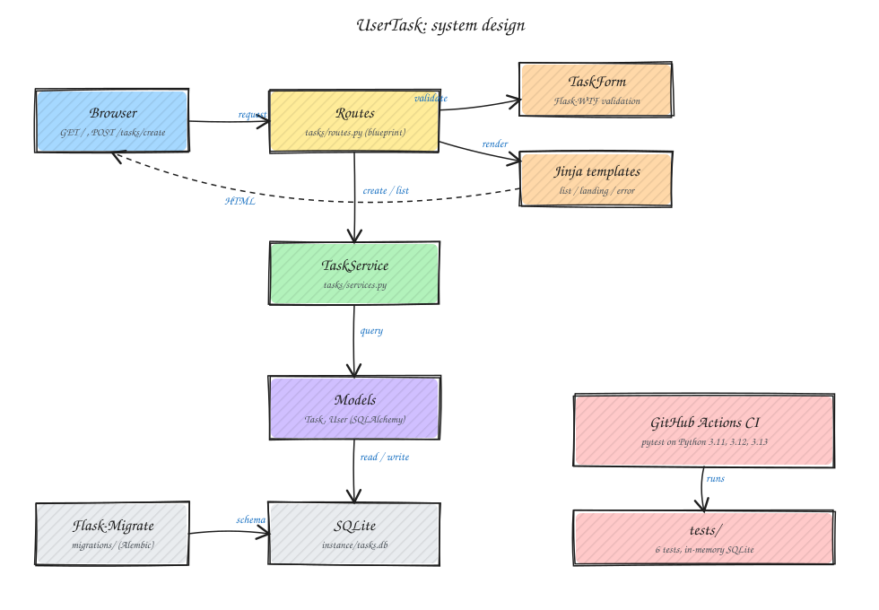

# UserTask

[](https://github.com/makambo13/UserTask/actions/workflows/ci.yml)

A small Flask app for a personal task list. Add a task with a title, a description and a priority, and the list shows the newest first.

<p align="center">
  
  
</p>

## Run

Needs Python 3.11 to 3.13. I tested 3.13. Python 3.14 does not work yet because of the pinned SQLAlchemy.

```sh
git clone https://github.com/makambo13/UserTask.git
cd UserTask
python3 -m venv venv
source venv/bin/activate
pip install -r requirements.txt
python run.py
```

Open http://127.0.0.1:5000. The SQLite database is created in `instance/` the first time the app starts.

## System design



A request goes from the browser to the routes. The routes check the form, call `TaskService` to read or save tasks, and render a Jinja template back to the browser. Flask-Migrate manages the database schema. To edit the diagram, open `docs/system-design.excalidraw` at [excalidraw.com](https://excalidraw.com).

## How it works

- `tasks/routes.py` handles requests
- `tasks/services.py` does the database work
- `tasks/models.py` defines `Task` and `User`
- `tasks/forms.py` has the Flask-WTF form

Not built yet: login, and editing, completing or deleting a task. Every task belongs to user 1.

## Tests and CI

```sh
pip install pytest
pytest -q
```

The 6 tests in `tests/` use an in-memory database, so they never touch `instance/tasks.db`. GitHub Actions runs them on Python 3.11, 3.12 and 3.13 for every push to `main` and every pull request.
