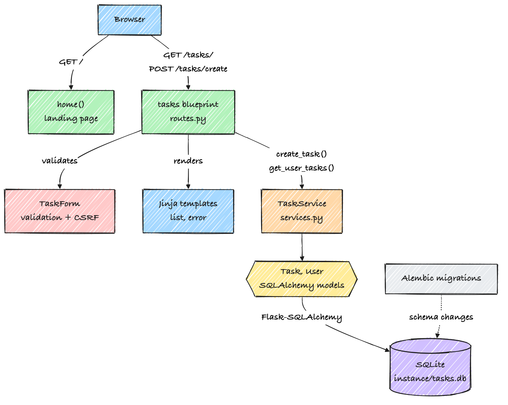

<div align="center">

# UserTask

A small Flask app for a personal task list.


<br>


&emsp;&emsp;


<sub>The landing page and the task list, with sample tasks.</sub>

</div>

## About

UserTask lets you add tasks with a title, a description and a priority, and lists them newest first. It runs on your machine with a local SQLite database. There is no account and no cloud service.

## Features

- Add a task with a title, an optional description, and a High, Medium or Low priority.
- See all tasks newest first, with the date each was created.
- Form validation and CSRF protection through Flask-WTF.
- Database changes are tracked with Alembic migrations.

## Getting started

You need Python 3.11 to 3.13. Python 3.14 does not work yet because of the pinned SQLAlchemy.

```bash
git clone https://github.com/makambo13/UserTask.git
cd UserTask
python3 -m venv venv
source venv/bin/activate
pip install -r requirements.txt
python run.py
```

Open http://127.0.0.1:5000. The SQLite database is created in `instance/` the first time the app starts. Set `SECRET_KEY` in your environment before running it anywhere other than your own machine.

## Using it

1. Open the landing page and click **Go to Your Task List**.
2. Fill in a title, a description if you want one, and a priority.
3. Click **Create Task**. The new task appears at the top of the list.

## How it works

The browser talks to two routes: the landing page, and the `tasks` blueprint at `/tasks/`. The blueprint checks the form, hands the work to `TaskService`, and renders the result with Jinja templates. `TaskService` reads and writes the `Task` and `User` models through Flask-SQLAlchemy. If a database call fails, the service rolls back and the app shows an error page.

<p align="center">
  
</p>

There are two tables. `user` has a username, an email and a password hash. `tasks` has a title, a description, a priority, a status (default `pending`), a created date, and the `user_id` of its owner.

## Limits

Login is not built yet, so every task is saved for user 1. You can't edit, complete or delete a task yet. If something doesn't work, please open an issue on GitHub.
