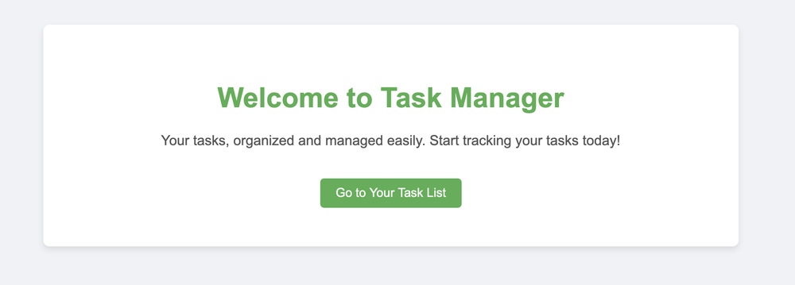
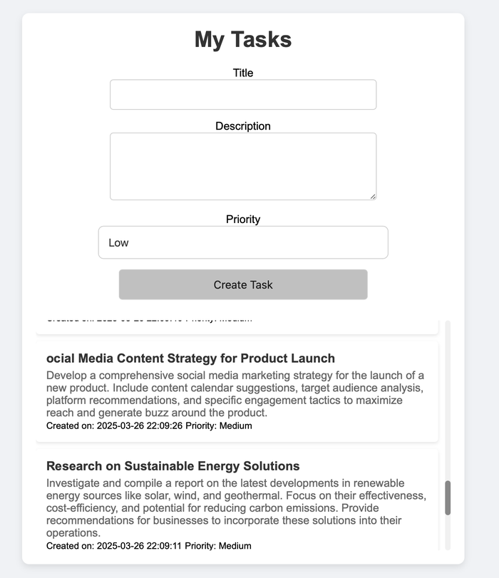
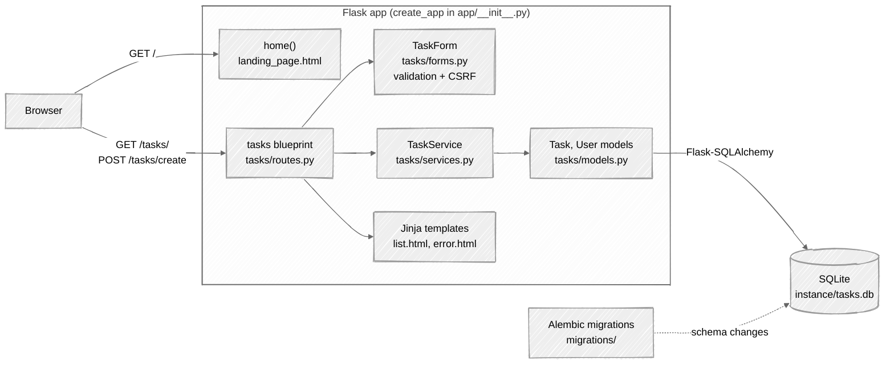
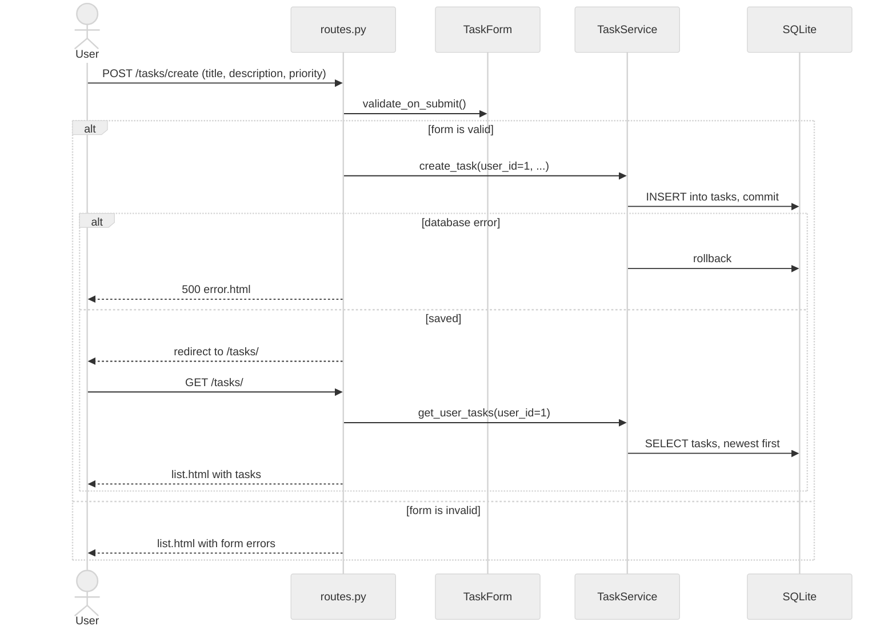
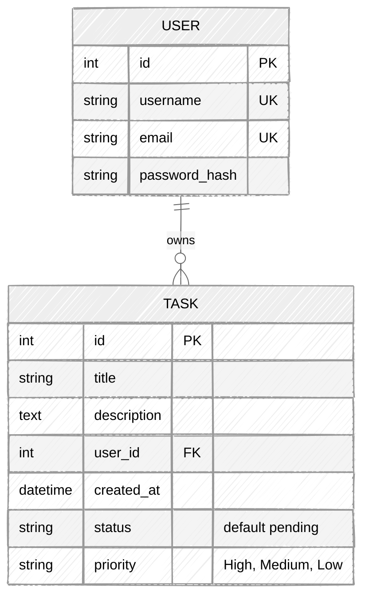

# UserTask

A small Flask app for a personal task list. Add a task with a title, a description and a priority, and the list shows the newest first.

<p align="center">
  
  
</p>

## Run

Needs Python 3.11 to 3.13. I tested 3.13. Python 3.14 does not work yet because of the pinned SQLAlchemy.

```sh
git clone https://github.com/makambo13/UserTask.git
cd UserTask
python3 -m venv venv
source venv/bin/activate
pip install -r requirements.txt
python run.py
```

Open http://127.0.0.1:5000. The SQLite database is created in `instance/` the first time the app starts.

## How it works

- `tasks/routes.py` handles requests
- `tasks/services.py` does the database work
- `tasks/models.py` defines `Task` and `User`
- `tasks/forms.py` has the Flask-WTF form

Not built yet: login, and editing, completing or deleting a task. Every task belongs to user 1.

## System design

### Architecture



### Request flow



### Data model



The `User` table exists, but login is not built yet, so every task is saved for user 1.
